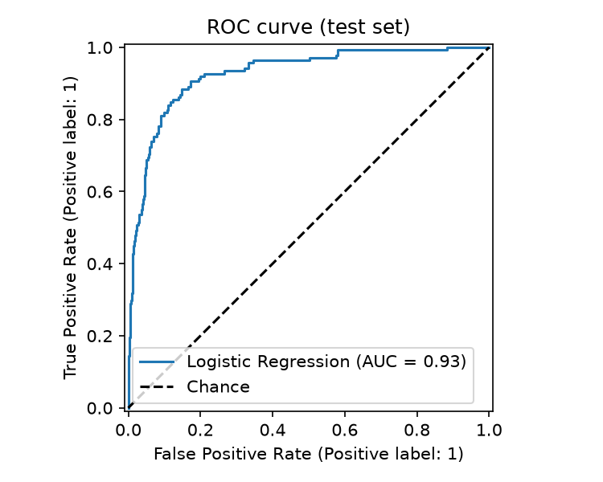
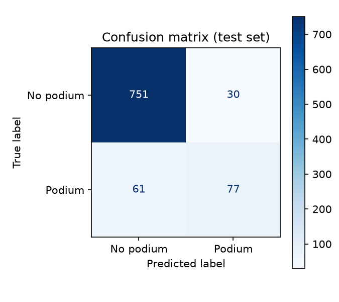
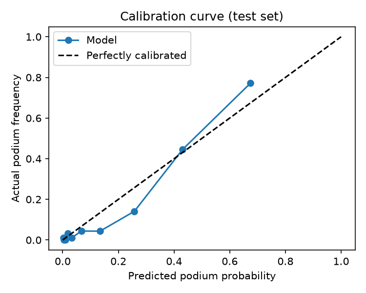
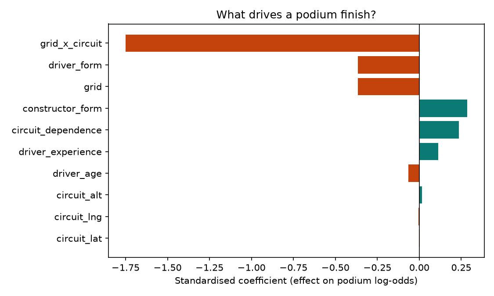
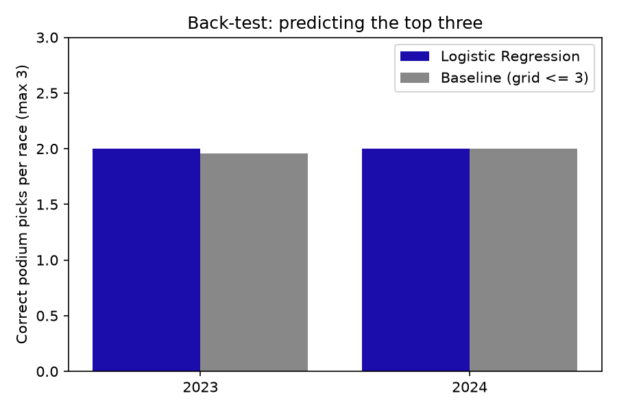
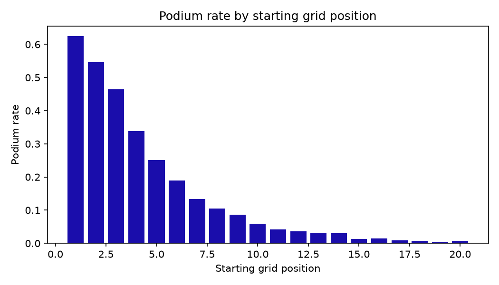
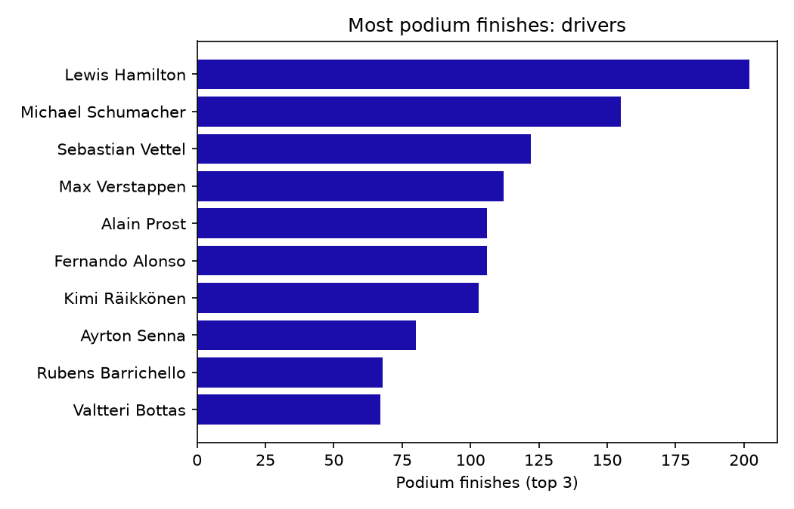
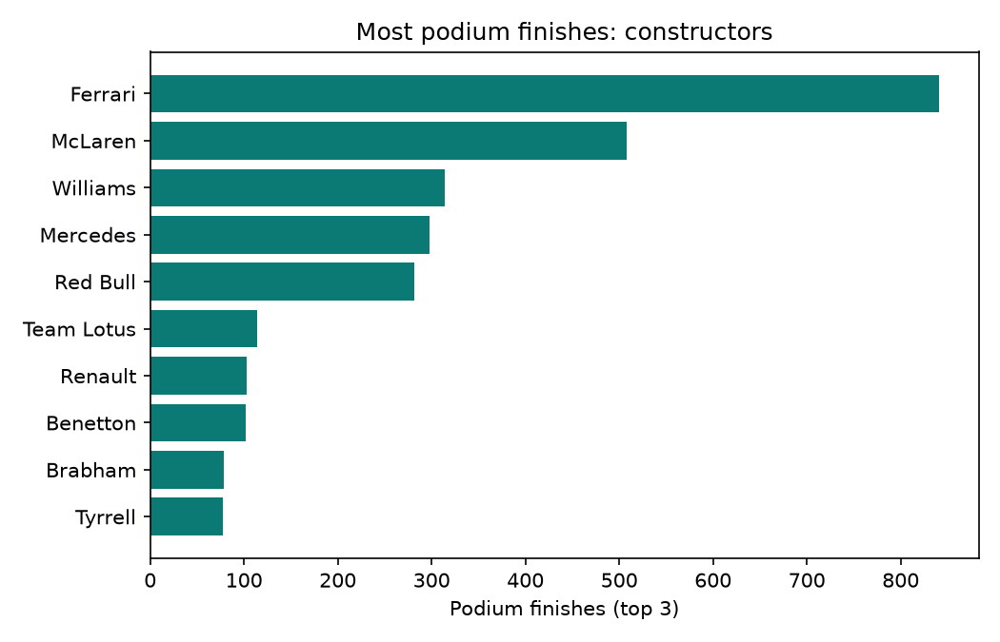
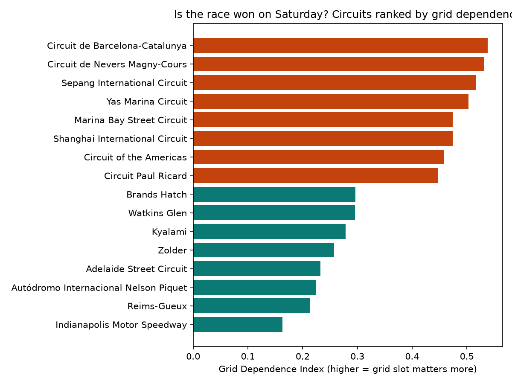

# 🏎️ F1 Podium Prediction: "Is the Race Won on Saturday?"

Predicts whether a Formula 1 driver finishes on the podium (top 3) from grid position, team strength, driver experience and circuit attributes, using **Logistic Regression** (pandas, scikit-learn, matplotlib).

  

---

## 👥 Team and Roles

| Member Name | Entry Number | Role | GitHub Handle |
| :--- | :--- | :--- | :--- |
| **Monika Singh** | `2026AIB1059` | Documentation Lead | [@2026AIB1059](https://github.com/2026AIB1059) |
| **Naitik Goyal** | `2026EEB1382` | Execution Lead | [@NaitikGo-Yal](https://github.com/NaitikGo-Yal) |
| **Princy Satapathy** | `2026EEB1395` | Video Lead | [@2026eeb1395](https://github.com/2026eeb1395) |
| **Ashmita Gupta** | `2026MCB1518` | PPT Lead | [@AshmitaGupta164](https://github.com/AshmitaGupta164) |

*All four members contributed code (see commit history).*

---

## 🎯 Problem Statement

Everyone says pole position matters, but how much it matters depends on the circuit. This project asks: **given a driver's starting grid slot, team strength, experience and the circuit, how likely is a podium finish?**

- **Task:** binary classification (podium = finish in top 3, otherwise not)
- **Model:** Logistic Regression (interpretable coefficients and odds ratios)
- **Baseline for comparison:** "podium if grid position ≤ 3"

## 📦 Dataset

- **Source:** [Formula 1 World Championship (1950-2024), Kaggle](https://www.kaggle.com/datasets/rohanrao/formula-1-world-championship-1950-2020) (compiled from the Ergast database)
- **Location in repo:** `Formula 1 Dataset/` (14 raw CSV files, included in the repo, so no download is needed)
- **Tables used:** results, races, drivers, constructors, circuits (joined on their IDs)
- **Size after cleaning:** `TODO: rows` rows, `TODO: columns` columns, seasons `TODO: start year`-`TODO: end year`
- **Cleaning notes:** grid position 0 means a pit-lane start in this dataset and is recoded; rows with missing fields are dropped

## 🧠 Approach

```text
Raw CSVs  ->  Join tables  ->  Feature engineering  ->  Train/test split  ->  Logistic Regression  ->  Metrics + plots
(14 files)   (results,        (grid, driver           (TODO: describe       (src/model.py)           (outputs/)
              races,           experience,             your split)
              drivers, ...)    constructor points,
                               circuit attributes)
```

**Features:** starting grid position, driver experience, constructor points, circuit attributes
**Target:** podium (1 if finishing position is 1, 2 or 3, else 0)
**Libraries:** pandas, numpy, scikit-learn, matplotlib (exact versions in `requirements.txt`)

---

## 📁 Project Structure

```text
AI101-team-81/
├── Formula 1 Dataset/   # 14 raw F1 CSV files
├── outputs/             # Generated plots and expected_output.png
├── src/
│   ├── main.py          # Entry point: loads data, runs pipeline, prints metrics
│   ├── model.py         # Model building, training and evaluation
│   ├── plots.py         # Visualisation scripts
│   └── utils.py         # Helper functions and metric formatters
├── requirements.txt     # Pinned project dependencies
└── README.md            # Project documentation
```

---

## ⚙️ Setup

Tested on **Python 3.10 and 3.11** (`TODO: confirm` on Windows / macOS / Ubuntu).

```bash
git clone https://github.com/2026AIB1059/AI101-team-81.git
cd AI101-team-81
python -m venv venv

# Activate the environment
source venv/bin/activate        # macOS / Linux
venv\Scripts\activate           # Windows

pip install -r requirements.txt
```

## 🚀 How to Run

Run from the repository root, in this order:

1. `python src/main.py`
2. The script loads and cleans the data from `Formula 1 Dataset/`, trains the model, prints the evaluation metrics in the terminal and saves the plots in `outputs/`.
3. Expected runtime: `TODO: e.g. under 30 seconds`.

### Expected Output










Plots saved in `outputs/`: `podium_rate_by_grid.png`, `top_drivers_podiums.png`, `top_constructors_podiums.png`, `grid_dependence_index.png`, `confusion_matrix.png`, `roc_curve.png`, `calibration_curve.png`, `feature_coefficients.png`, `backtest_top3.png`

---

## 📊 Results

| Metric | Baseline (grid <= 3) | Logistic Regression |
| :--- | :--- | :--- |
| Accuracy | 0.897 | 0.901 |
| Precision | 0.657 | 0.720 |
| Recall | 0.652 | 0.558 |
| ROC-AUC | 0.911 | 0.928 |

**Key finding:** Logistic Regression achieved a higher accuracy (90.1%) and precision (72.0%) than the baseline, with grid position combined with circuit dependence (`grid_x_circuit`) having the strongest negative impact on podium probability.

---

## 🔗 Project Deliverables

- 📊 **Presentation Slides (5):** `TODO: docs/Team81_slides.pdf` (or public link)
- 🎥 **Demo Video (max 5 min):** `TODO: unlisted YouTube / Drive link`

---

## 🤝 Contributions

| Member | Contribution |
| :--- | :--- |
| Monika Singh | README, project structure and documentation, `TODO` |
| Naitik Goyal | `requirements.txt`, model.py, main.py, utils.py, plots.py, programming/ executing code, AI modelling, fresh-clone testing, `TODO` |
| Princy Satapathy | Demo video, `TODO` |
| Ashmita Gupta | 5-slide presentation, `TODO` |

---

## 🤖 AI-Use Disclosure

- **ChatGPT:** `TODO: what for` (e.g. debugging a plotting error in `src/plots.py`); we tested the fix.
- **Gemini:** `TODO: what for` (e.g. first draft of this README); edited by `TODO: name`.
- **Claude:** `TODO: remove this line if not used` (e.g. helped plan the problem statement and features); we reviewed and verified the output.
- **Code verification:** all machine learning pipeline code, logic and data paths were reviewed, executed and tested by the team, and every member can explain it.
- No AI was used to generate the dataset or the results.

